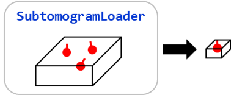
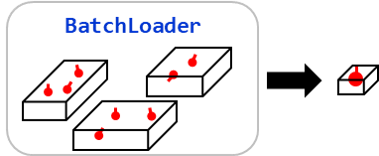
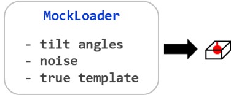
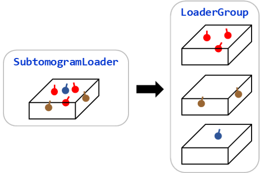

==================
Subtomogram Loader
==================

The main classes that actually perform subtomogram analysis are called "subtomogram loaders".
A subtomogram loader is a pair of image(s) and a :class:`Molecules` object, with
efficient mothods for loading, averaging or aligning subtomograms.

Currently, there are four subtomogram loaders in :mod:`acryo`.

1. :class:`SubtomogramLoader`

   |pic1|

   A subtomogram loader that loads subtomograms from a single tomogram image.

2. :class:`BatchLoader`

   |pic2|

   A subtomogram loader that loads subtomograms from multiple pairs of a tomogram image and
   a :class:`Molecules` object.

3. :class:`MockLoader`

   |pic3|

   A subtomogram loader that generates mock subtomograms.

4. :class:`BackProjectionLoader`

   A subtomogram loader that reconstructs subtomograms directly from a tilt series.

These loaders have the same API. Here, I start with the :class:`SubtomogramLoader` class to
show the basic usage of subtomogram loaders.

.. contents:: Contents
    :local:
    :depth: 1

Creating a :class:`SubtomogramLoader`
=====================================

|pic1|

A :class:`SubtomogramLoader` is a pair of a 3D tomogram image and a
:class:`Molecules` object, with some additional parameters.

.. code-block:: python

    def __init__(self, image, molecules, order=3, scale=1.0, output_shape=Unset(), corner_safe=False, tilt_model: TiltSeriesModel | None = None,): ...

1. ``image`` (`numpy.ndarray` or `dask.Array`) ... the tomogram image.
2. ``molecules`` (`Molecules`) ... molecules in the tomogram.
3. ``order`` (`int`) ... order of the spline interpolation. 0=nearest, 1=linear, 3=cubic.
4. ``scale`` (`float`) ... scale (nm/pixel) of the tomogram image. This
   parameter must match the positions of ``molecules``.
5. ``output_shape`` (`tuple`) ... shape of the output subtomograms, which will be
   used to determine the subtomogram shape during subtomogram averaging.
6. ``corner_safe`` (`bool`) ... if true, the subtomogram loader will ensure that
   the volume inside the given output shape will not be affected after rotation,
   otherwise the corners of the subtomograms will be dimmer.

:class:`SubtomogramLoader` can be constructed from a image file using the :meth:`imread` method
or the public :func:`imread` function.

.. code-block:: python

    from acryo import Molecules, imread

    loader = imread("path/to/image.mrc", Molecules.from_csv("path/to/molecules.csv"))

Subtomogram Averaging
=====================

:meth:`average` crops all the subtomograms around the molecules and
average them. This method always returns a 3D :class:`numpy.ndarray` object.

.. code-block:: python

    from dask import array as da
    from acryo import SubtomogramLoader, Molecules

    image = da.random.random((100, 100, 100))
    molecules = Molecules([[40, 40, 60], [60, 60, 40]])

    # give output shape beforehand
    loader = SubtomogramLoader(image, molecules, output_shape=(64, 64, 64))
    avg = loader.average()

    # or give output shape after construction
    loader = SubtomogramLoader(image, molecules)
    avg = loader.average(output_shape=(64, 64, 64))

Subtomogram Alignment
=====================

Templated alignment
-------------------

:meth:`align` crops all the subtomograms around the molecules and
align them to the given template image (reference image). This method will return
a new :class:`SubtomogramLoader` object with the updated :class:`Molecules` object.

You have to provide a template image, optionally a mask image, maximum shifts
**in nanometers** and an alignment model. The default alignment model is
:class:`ZNCCAlignment`. For more details about the alignment models, see :doc:`./alignment`.

.. code-block:: python

    from dask import array as da
    from acryo import SubtomogramLoader, Molecules

    image = da.random.random((100, 100, 100))
    template = np.random.random((20, 20, 20))
    molecules = Molecules([[40, 40, 60], [60, 60, 40]])

    loader = SubtomogramLoader(image, molecules)
    out = loader.align(template, max_shifts=(5, 5, 5))

If you want to give parameters to the alignment model, you can use the :meth:`with_params`
method of alignment model classes, or directly pass them to the ``**kwargs``.

.. code-block:: python

    from acryo.alignment import ZNCCAlignment

    loader = SubtomogramLoader(image, molecules)

    # use with_params
    out = loader.align(
        template,
        max_shifts=(5, 5, 5),
        alignment_model=ZNCCAlignment.with_params(
            rotations=[(6, 2), (6, 2), (6, 2)],
            cutoff=0.5,
            tilt=(-50, 50)
        ),
    )

    # directly pass them to the **kwargs
    out = loader.align(
        template,
        max_shifts=(5, 5, 5),
        alignment_model=ZNCCAlignment,
        rotations=[(6, 2), (6, 2), (6, 2)],
        cutoff=0.5,
        tilt=(-50, 50),
    )

Template-free alignment
-----------------------

If no a priori information is available for the template image, you'll use the subtomogram
averaging result as the template image. During this task, each subtomogram will be loaded
twice so it is not efficient to call :meth:`average` and :meth:`align` separately.

:meth:`align_no_template` creates a local cache of subtomograms so that alignment will be
faster.

.. code-block:: python

    loader = SubtomogramLoader(image, molecules)
    out = loader.align_no_template(max_shifts=(5, 5, 5), output_shape=(20, 20, 20))

Multi-template alignment
------------------------

If a tomogram is composed of heterogeneous molecules, you can use multiple templates to
align the molecules and determine the best template for each molecule.

.. code-block:: python

    loader = SubtomogramLoader(image, molecules)
    out = loader.align_multi_templates(
        [template0, template1, template2],
        max_shifts=(5, 5, 5),
        label_name="template_id",
    )
    out.molecules.features["template_id"]  # get the best template id for each molecule

Here, input templates must be given as a list of :class:`numpy.ndarray` objects of the
same shape. ``label_name`` is the name used for the feature colummn of the best template.

Image preprocessing workflow
----------------------------

During subtomogram alignment, template images and mask images are usually provided from
image files. They also need preprocessing such as rescaling and smoothing.

See :doc:`./pipe` for the details.

Filtering Loader
================

:meth:`filter` is the method quite similar to that in :class:`Molecules` or :class:`DataFrame`.
It returns a new :class:`SubtomogramLoader` object with the filtered molecules.

.. code-block:: python

    loader = SubtomogramLoader(image, molecules)
    out = loader.filter(pl.col("score") > 0.5)

    # all scores are greater than 0.5 after filtering
    assert (out.molecules.features["score"] > 0.5).all()

This method is useful to filter out bad alignment,

.. code-block:: python

    loader.filter(pl.col("score") > 0.5)

choose molecules in certain regions,

.. code-block:: python

    loader.filter((10 < pl.col("x")) & (pl.col("x") < 20))

pick certain isotypes,

.. code-block:: python

    loader.filter(pl.col("cluster_id") == 1)

and so on.

Grouping Loader
===============

Subtomogram loaders have a :meth:`groupby` method. You can group molecules by a feature, create
corresponding subtomogram loaders and perform the same subtomogram analysis workflow efficiently.

See :doc:`./group` for the details.

Loading from Collection of Tomograms
====================================

|pic2|

Cryo-ET image analysis is usually performed on a collection of tomograms. Data management
becomes very complicated in this case.

:mod:`acryo` provides a :class:`BatchLoader` class for this purpose. :class:`BatchLoader`
shares the same interface with :class:`SubtomogramLoader`. It is constructed using the same parameters.

.. code-block:: python

    def __init__(self, order=3, scale=1.0, output_shape=Unset()): ...

:class:`BatchLoader` can be constructed from a list of :class:`SubtomogramLoader` objects.

.. code-block:: python

    from acryo import Molecules, imread, BatchLoader

    collection = BatchLoader.from_loaders(
        [
            imread("path/to/image-0.mrc", Molecules.from_csv("path/to/molecules-0.csv")),
            imread("path/to/image-1.mrc", Molecules.from_csv("path/to/molecules-1.csv")),
            imread("path/to/image-2.mrc", Molecules.from_csv("path/to/molecules-2.csv")),
        ],
    )

.. code-block:: python

    avg = collection.average(output_shape=(20, 20, 20))
    out = collection.align(template, max_shifts=(5, 5, 5))
    group = collection.groupby("cluster_id")

Other loaders, such as :class:`BackProjectionLoader`, can also be added. Subtomograms
are loaded by each loader with the molecules, interpolation order and scale of the
:class:`BatchLoader`. For :class:`BackProjectionLoader`, the scale is converted to the
binning factor of the tilt series.

.. code-block:: python

    from acryo import BackProjectionLoader

    collection = BatchLoader(scale=0.68)
    collection.add_loader(imread("path/to/image-0.mrc", molecules_0))
    collection.add_loader(BackProjectionLoader(tilt_series_1, molecules_1))
    sub = collection.loaders[1]  # binsize is 0.68 / tilt_series_1.scale

Mock Loader for Testing
=======================

|pic3|

:class:`MockLoader` is for testing purpose only. The tomogram does not actually exist
but subtomograms are generated on the fly based on the template image. Subtomograms
are generated by following steps.

1. Affine transformation of the template image, based on the molecule position and rotation.
2. Calculate projections in different angles (Discrete Radon transformation).
3. Add noise to the projection.
4. Reconstruct the subtomogram (Weighted Back projection).

:class:`MockLoader` is constructed using the following parameters.

.. code-block:: python

    def __init__(self, template, molecules, noise=0.0, degrees=None, central_axis=(0.0, 1.0, 0.0), ...): ...

1. ``template`` (`numpy.ndarray or ImageProvider`): template image that will be used to generate
   subtomograms.
2. ``molecules`` (`Molecules`): pseudo molecules. The true center of the molecules is always at
   (0, 0, 0) and the true rotation is always the identity rotation. If you want to test shifting,
   say, [2, 3, 4], set the molecules position to [-2, -3, -4]. Same for rotation.
3. ``noise`` (`float`): noise level. The noise is added to the projection of the template.
4. ``degrees`` (`float`): tilt series rotation angles in degree.
5. ``central_axis`` (`tuple`): central axis vector of the tilt series. The default is (0, 1, 0) which
   means the tilt series is rotated around the y-axis.

Reconstructing Subtomograms from a Tilt Series
==============================================

:class:`BackProjectionLoader` does not need a tomogram. Subtomograms are reconstructed
from a tilt series every time they are needed, at the pixel size given by ``scale``, by
direct Fourier inversion (insertion of the central slices into the 3D Fourier transform).
Reading the tilt images requires ``mrcfile``.

The tilt series is given as a :class:`acryo.projection.TiltSeries` object, which describes
the alignment of the tilt series in nm. The alignment of IMOD (``etomofiles`` is required),
AreTomo (``alnfile`` is required) and RELION 5 (``starfile-rs`` is required) can be read.
The tilt series and the reconstruction are ported from
`torch-reconstruct-tomogram <https://github.com/teamtomo/torch-reconstruct-tomogram>`_ and
`torch-tilt-series <https://github.com/teamtomo/torch-tilt-series>`_ in numpy and scipy, so
``torch`` is not needed. Because the tilt series
defines the coordinates relative to the tomogram center, the position of the tomogram center
in the coordinate system of the molecules has to be given as ``tomogram_center`` (in nm).
Depending on the positive direction of the tilt angles, the handedness of the tomogram may be
inverted. In this case, set ``tomo_hand=-1`` to mirror the tomogram along the z axis around
the tomogram center.

.. code-block:: python

    from acryo import Molecules, BackProjectionLoader
    from acryo.projection import TiltSeries

    # pixel size of the raw tilt images in nm
    tilt_series = TiltSeries.from_aretomo_output("path/to/tilt_series.aln", scale=0.217)
    molecules = Molecules.from_csv("path/to/molecules.csv")
    loader = BackProjectionLoader(
        tilt_series,
        molecules,
        binsize=4,  # pixel size of the subtomograms is 0.217 * 4 = 0.868 nm
        output_shape=(32, 32, 32),
        tomogram_center=(D // 2 * s, H // 2 * s, W // 2 * s),  # tomogram of shape (D, H, W)
    )
    avg = loader.average()

The pixel size of the subtomograms (``loader.scale``) is the pixel size of the tilt images
(``tilt_series.scale``) times ``binsize``, which does not have to be an integer.
:meth:`binning` returns a loader of a larger ``binsize``.

A tilt series of RELION 5 is read from the STAR file of tilt series (such as
``tilt_series.star`` of an "Align tilt series" job), with the name of the tilt series. The
motion-corrected tilt images (``rlnMicrographName``) are read one by one. The paths in the
STAR files are relative to the RELION project directory, which is found from the parent
directories of the STAR file (or given as ``project_dir``). The tomogram space of RELION is
centered, so the centered coordinates of the particles (``rlnCenteredCoordinateXAngst`` etc.)
can be used with ``tomogram_center=(0, 0, 0)``.

.. code-block:: python

    tilt_series = TiltSeries.from_relion_tilt_series_star(
        "path/to/AlignTiltSeries/job005/tilt_series.star", "TS_01"
    )

The tilt images are preprocessed by :class:`acryo.projection.TiltImagePreprocessor`
(background subtraction, bandpass filtering and normalization of each tilt image). Each
tilt image is split into overlapping patches (3 x 3 by default, ``patch_grid``), which are
filtered separately with a margin of ``padding`` pixels and blended in the overlapping
regions (``overlap`` pixels). If the tilt images are binned, the Fourier transform of each
patch is cropped before the inverse transform, so the binned images are computed directly.
The parameters can be changed by giving a preprocessor to ``preprocess``.

The CTF of the tilt images is corrected by phase flipping if the tilt series has the CTF
parameters (``tilt_series.ctf``, a :class:`acryo.ctf.TiltSeriesCTF`). They are read by
default by :meth:`TiltSeries.from_etomo_directory` (the defocus file of ctfplotter and the
parameters in ctfcorrection.com or ctfplotter.com) and
:meth:`TiltSeries.from_relion_tilt_series_star` (``rlnDefocusU``, ``rlnDefocusV``,
``rlnDefocusAngle`` and the optics in the global data block). Each patch is phase-flipped
with the defocus at its center, which is corrected for the depth of the specimen in the
tilted image by :class:`acryo.ctf.PatchCTFCorrection` (see
:meth:`TiltSeries.ctf_correction`). Give ``ctf=False`` to the ``from_*`` methods to read
the tilt series without the CTF parameters.

.. code-block:: python

    tilt_series = TiltSeries.from_etomo_directory("path/to/etomo", scale=0.217)
    tilt_series.ctf  # TiltSeriesCTF of each tilt, or None if not found
    loader = BackProjectionLoader(tilt_series, molecules)  # CTF is corrected

The direction of the defocus gradient is given by ``hand`` of the CTF correction, which is
-1 (the standard geometry, ``rlnTomoHand = -1`` of RELION or IMOD without
``InvertTiltAngles``) by default. The handedness is not read from the files, but a warning
is issued if they indicate the inverted one. In this case, give the CTF correction with
``hand=1``.

.. code-block:: python

    from acryo.projection import TiltImagePreprocessor

    preprocessor = TiltImagePreprocessor().with_filters(tilt_series.ctf_correction(hand=1))
    loader = BackProjectionLoader(tilt_series, molecules, preprocess=preprocessor)

Additional Fourier filters can be applied to each tilt image. For example, the CTF can also
be corrected by phase flipping or Wiener filtering with the :class:`acryo.ctf.CTFModel` of
each tilt, for the whole tilt image (a CTF correction in the preprocessor is not added
again from the tilt series).

.. code-block:: python

    from acryo.ctf import CTFModel
    from acryo.projection import TiltImagePreprocessor

    ctf = CTFModel.from_kv(300, spherical_aberration=2.7)
    preprocessor = TiltImagePreprocessor(low=0.01).with_ctf(
        ctf,
        defocus=defocus,  # defocus of each tilt in μm (negative for underfocus)
        method="phase_flip",  # or "wiener"
    )
    loader = BackProjectionLoader(tilt_series, molecules, preprocess=preprocessor)

Any function ``filter(freq_y, freq_x, index)`` that returns the values multiplied to the
Fourier transform of the ``index``-th tilt image (spatial frequencies in 1/nm) can be added
by :meth:`TiltImagePreprocessor.with_filters`. A filter with the attribute
``position_dependent = True`` is called for each patch with the keyword argument
``position``, the (y, x) coordinates of the center of the patch in nm from the center of the
tilt image.

The tilt images are read from the file tilt by tilt, preprocessed, and binned by the largest
integer factor whose pixel size does not exceed ``scale``, so the raw tilt series is never in
memory all at once. Each tilt image is read and preprocessed in a task of a dask graph, and
the tasks run in parallel threads. For binning by 4 or more (``real_space_binning`` of the
preprocessor), the tilt images are first binned in real space by the largest integer that
does not exceed the binning factor and divides the image size, and the rest of the binning
(which may be fractional) and the preprocessing are done in Fourier space. The resolution
near the Nyquist frequency of the binned images is slightly attenuated, but the
preprocessing is several times faster. Subtomograms are reconstructed lazily and in parallel by :mod:`dask`. A
cube aligned to the tomogram axes is reconstructed around each molecule, and the subtomogram
is cropped from the cube with the rotation of the molecule, in the same way as
:class:`SubtomogramLoader` (interpolation order ``order``, and larger cubes if
``corner_safe=True``). All the cubes share the same geometry, so the insertion of the central
slices is computed only once as a sparse matrix.

By default, the preprocessed tilt images are released after each computation, and they are
read and preprocessed again in the next one. To reuse them in repeated computations, use
:meth:`BackProjectionLoader.cache_tilt_images`. In this context, the preprocessed images
are cached in memory and shared by the loaders created from the loader (such as the results
of :meth:`align` or :meth:`binning`). The cache is released when the context exits.

.. code-block:: python

    with loader.cache_tilt_images():
        aligned = loader.align(template, max_shifts=1.0)
        avg = aligned.average()

Tilt images can be excluded from the reconstruction by
:meth:`BackProjectionLoader.exclude_tilts`, such as those damaged by the electron dose or
blocked by the grid bars. The indices are of the tilts in the tilt series of the loader
(``loader.tilt_series.tilt_angles[i]``), not of the images in the file, which differ if
some views were already excluded when the tilt series was read (such as by
:meth:`TiltSeries.from_etomo_directory`). The filters of the preprocessor, such as the CTF
correction, stay matched to their tilts, and the default tilt model is created again from
the remaining tilt angles. :meth:`TiltSeries.select_tilts` returns the tilt series of the
selected tilts.

.. code-block:: python

    loader = loader.exclude_tilts([0, 1])  # exclude the first two tilts
    angles = loader.tilt_series.tilt_angles
    loader = loader.exclude_tilts(np.flatnonzero(np.abs(angles) > 50))

The 3D Fourier transform of each cube is padded by the factor ``padding`` (2 by default).
Densities outside the padded cube, such as neighboring molecules, are partly aliased into the
cube. If the molecules are densely packed, a larger ``padding`` (such as 3) gives subtomograms
closer to those from a reconstructed tomogram, at the cost of speed.

The functions for reconstruction and projection (:class:`acryo.projection.VolumeProjector`)
are available in :mod:`acryo.projection`.

The full tomogram can also be reconstructed at the pixel size of ``scale`` from the
preprocessed tilt images. The tomogram is tiled by patches, which are reconstructed by direct
Fourier inversion and blended with cosine-tapered margins. The tomogram is centered at
``tomogram_center``, so if ``tomogram_center`` is ``shape // 2 * scale``, it can directly be
used with :class:`SubtomogramLoader`.

.. code-block:: python

    tomogram = loader.reconstruct_tomogram((D, H, W))
    SubtomogramLoader(tomogram, loader.molecules, scale=loader.scale)

The patches are reconstructed row by row along the z axis, and only a slab of the size of the
patches is kept besides the output. If ``save_path`` is given, an MRC file of the tomogram is
allocated beforehand and the slabs are written to it, so the tomogram is never in memory all
at once. A read-only memory map of the file is returned.

.. code-block:: python

    tomogram = loader.reconstruct_tomogram((D, H, W), save_path="tomogram.mrc")

The tomogram is float16 by default (MRC mode 12 if saved), which is half the size of float32.
Give ``dtype=np.float32`` for full precision. :class:`SubtomogramLoader` accepts float16
tomograms (subvolumes are converted to float32).

The same reconstruction is available for any tilt images and tilt series as
:func:`acryo.projection.reconstruct_tomogram`.

Local Shifts of the Tilt Images
-------------------------------

Deviations of the projections from the rigid geometry of the tilt series are given as
``local_shifts_2d`` of :class:`acryo.projection.TiltSeries`, a model of the shifts of the
projected points on the detector. The models are serializable (``TiltSeries.dump_json``):

- :class:`acryo.projection.LocalShifts2D`: smooth shifts of each tilt image interpolated from
  a grid of control points (the result of :meth:`refine_tilt_series`).
- :class:`acryo.projection.AffineShifts2D`: an affine transformation of each tilt image, such
  as a change of magnification.
- :class:`acryo.projection.LocalAlignment`: the local alignments of IMOD. The sample is
  divided into local areas, each of which has increments of the tilt angles, the X-axis tilt
  angles, the Z factors and an affine refinement of each tilt. The shifts depend on the 3D
  positions of the points.

A model can have another model as ``base``, which is applied before the model. Any function
of the projected points is also accepted as ``local_shifts_2d``, but it cannot be serialized.

The rotation of the transformation of each view of IMOD (.xf) is the tilt axis angle, and the
rest, such as the change of magnification, is read as :class:`AffineShifts2D`. The local
alignments of IMOD (``LOCALFILE`` of tilt.com) are read with ``local_alignment=True``, so the
results with and without them can be compared.

.. code-block:: python

    tilt_series = TiltSeries.from_etomo_directory("path/to/etomo", scale=0.266)
    tilt_series_local = TiltSeries.from_etomo_directory(
        "path/to/etomo", scale=0.266, local_alignment=True
    )

:meth:`refine_tilt_series` uses the projection including these models, so the alignment
can be refined on top of the local alignments of IMOD.

Refining the Alignment of a Tilt Series
---------------------------------------

Similar to Bayesian polishing, the alignment of the tilt series can be refined using particles
and their templates. :meth:`BackProjectionLoader.refine_tilt_series` compares the
projections of the templates placed at the particles with the tilt images, and returns a new
loader with the refined tilt series. Particles of different kinds can be used together with
their own templates. The templates must be in the pixel size of ``scale`` and in the same
contrast as the subtomograms (such as the averages of this loader).

.. code-block:: python

    refined = loader.refine_tilt_series(
        [(ribosomes, ribosome_template), (microtubules, microtubule_template)],
        max_shift=2.0,  # nm
    )

The in-plane rotation of each tilt image (``tilt_axis_angle``) can also be refined by
``rotation=(max, step)`` in degrees. The tilt axis angle of each tilt is searched from
``-max`` to ``max`` by ``step`` around the current one, and the shifts are refined at the
angle with the highest correlation. The computation time is proportional to the number of
the angles.

.. code-block:: python

    refined = loader.refine_tilt_series(
        [(ribosomes, ribosome_template)],
        rotation=(2.0, 0.5),  # search -2.0, -1.5, ..., 2.0 degrees
    )

By default, a uniform shift is refined for each tilt image (``sample_translations``). If
``grid_shape`` is larger than ``(1, 1)``, the shifts are refined as a smooth field over each
tilt image, interpolated from a grid of control points (``local_shifts_2d``). The control
points are optimized to maximize the correlation of the particles with a smoothness prior
weighted by ``smoothness``. The refined shifts are added to the existing local shifts (such
as :class:`acryo.projection.LocalAlignment`), which are kept as the ``base`` of the refined
:class:`acryo.projection.LocalShifts2D`.

.. code-block:: python

    refined = loader.refine_tilt_series(
        [(ribosomes, ribosome_template)],
        grid_shape=(3, 3),
        smoothness=0.01,
    )

Scores in Each Tilt Image
-------------------------

:meth:`BackProjectionLoader.score_on_tilt` compares the projections of the templates with
the tilt images, instead of the reconstructed subtomograms as :meth:`score`. Each template is
projected to each tilt image at the position and orientation of each molecule, and compared
with the patch of the tilt image at the projected position by ZNCC (or NCC with
``method="ncc"``). No shift is searched. The result is an array of shape
``(n_templates, n_molecules, n_tilts)``, which is useful to find tilt images or molecules that
do not fit the alignment of the tilt series. The mask is projected in the same way as the
templates and multiplied to both the projections and the patches, and ``cutoff`` is the
cutoff frequency of the low-pass filter in the same unit as the alignment models.

.. code-block:: python

    scores = loader.score_on_tilt([template], mask=mask, cutoff=0.3)  # (1, N, T)
    scores_per_tilt = scores[0].mean(axis=0)  # (T,)

CTF of the Projections
----------------------

If the tilt series has the CTF parameters (``tilt_series.ctf``), ``ctf=True`` of
:meth:`BackProjectionLoader.score_on_tilt` and :meth:`BackProjectionLoader.refine_tilt_series`
applies the CTF to the projections of the templates. The defocus of each molecule in each tilt
is the defocus of the tilt series (at the tomogram center) changed by the depth of the molecule
in the microscope, which depends on its position (including the z coordinate) and the tilt
angle (:meth:`acryo.projection.TiltSeries.point_depths`). The projections are then filtered by
the filters of the preprocessor at the projected positions, such as the CTF correction by
phase flipping, so that they are comparable with the preprocessed tilt images. The handedness
of the defocus gradient is that of the :class:`acryo.ctf.PatchCTFCorrection` of the
preprocessor, or the standard one (-1) by default.

.. code-block:: python

    scores = loader.score_on_tilt([template], ctf=True)
    refined = loader.refine_tilt_series([(molecules, template)], ctf=True)
